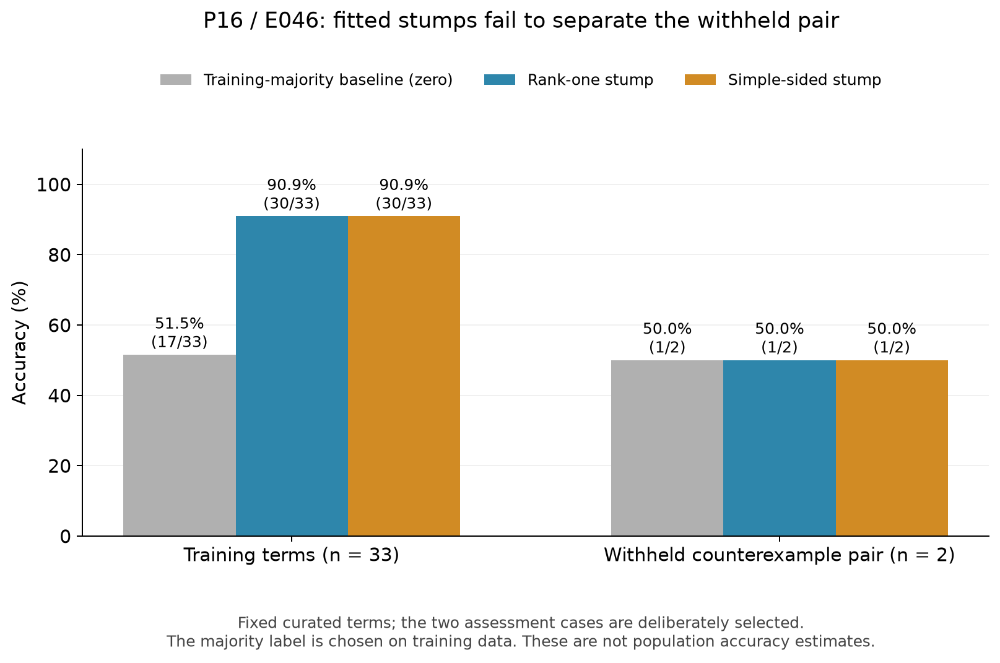
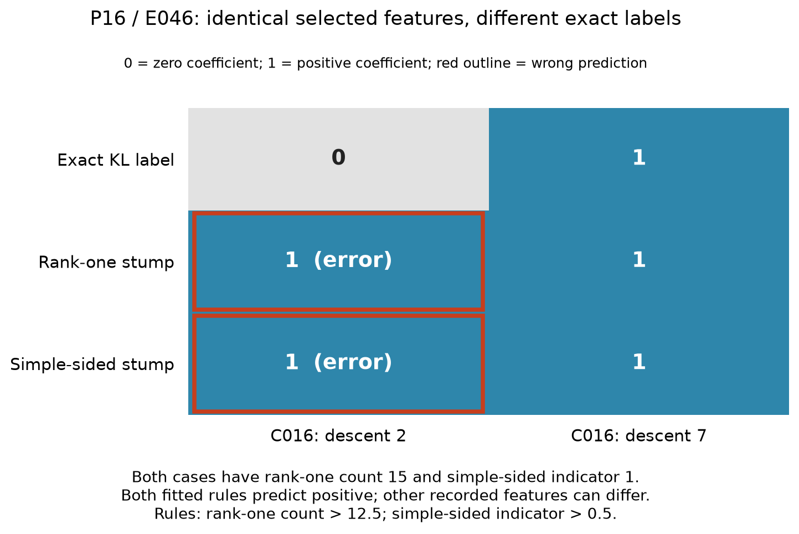
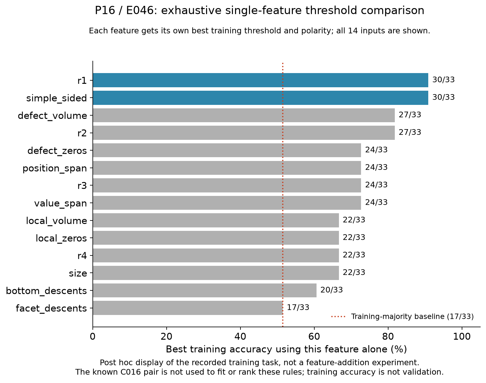
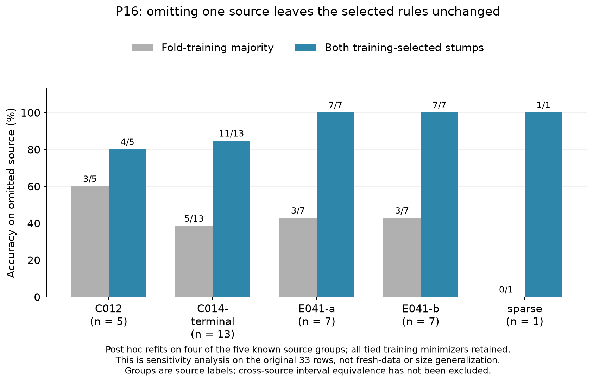

# P16 model figures

E046 fitted two equally best decision stumps on exact KL coefficient labels. These plots summarize that recorded experiment. They use the visual conventions of the repository's Kronecker figures, with exact counts and assessment scope shown explicitly.

## Accuracy versus baseline



[Vector PDF](fig1_accuracy_vs_baseline.pdf). Both fitted stumps classify 30/33 training terms correctly, compared with 17/33 for the training-majority zero predictor. Each method classifies one of the two withheld terms correctly. The assessment pair is a selected counterexample, not a random test sample; its 50% accuracy is not an estimate of population performance.

## The withheld pair



[Vector PDF](fig2_withheld_pair.pdf). The two C016 terms have equal values of the two selected features but exact labels zero and one. Both fitted thresholds predict positive for both terms. Other recorded features differ, so this demonstrates the failure of the selected rules rather than indistinguishability under the entire feature representation. The stored descent labels 2 and 7 are one-based (`i+1` in the dataset writer); permutation entries are zero-based.

## All single-feature fits



[Vector PDF](fig3_feature_comparison.pdf). Each of the 14 recorded features is fitted separately using the original exhaustive threshold/polarity search on the 33 training rows. The figure shows every feature, sorted by training errors, with all minimizing rules retained in the JSON. The rank-one count and simple-sided indicator each make three errors; other features make six to sixteen. This is a post hoc comparison of one-feature fits, not an incremental feature-addition experiment or evidence of validation performance. The C016 pair is excluded from fitting and ranking.

## Sensitivity to omitting a source



[Vector PDF](fig4_source_sensitivity.pdf). This additional analysis, performed on 2026-09-25, omits each of the five known source groups, refits the full original stump search on the other four, and evaluates every tied training minimizer on the omitted rows. Every refit selects the same two rules as the full training set. Correct counts are 4/5, 11/13, 7/7, 7/7, and 1/1; both tied rules agree on those counts. The majority baseline is fitted separately on each fold, choosing zero on a tied training class count. No rule is selected using assessment accuracy.

This establishes stability under these five omissions. It does not supply fresh confirmation: the original examples were already known, the source groups are unequal, and cross-source interval equivalence has not been excluded. The one-row group is especially limited. These are new post hoc refits, recorded separately from the historical E046 run and campaign session counts. The unchanged rules still fail to separate the known C016 pair.

## Coverage and limits

| Evidence question | Available here |
| --- | --- |
| Model accuracy relative to a baseline | Figure 1; explicit training and selected-pair counts |
| A concrete failure of the learned rules | Figure 2; exact contrasting labels |
| Comparison across input features | Figure 3; all 14 single-feature fits, training only |
| Sensitivity to source selection | Figure 4; post hoc source-omission refits |
| Controlled neural interventions, fresh larger-size replication, or an incremental feature ladder | Not established by these selected experiments |

This coverage differs from the Kronecker collection. More plots of the same 35 rows would not create an independent generalization study. The mathematical reductions and remaining conjecture have a separate [proof record](../paper/proofs.md).

## Data and reproduction

[generate.py](generate.py) reads the [publication replay](../research/artifacts/publication_replay.json), recomputes predictions and counts, and runs the additional deterministic fits using the original `best_stumps` function. It writes PNG/PDF figures plus [plot_data.json](plot_data.json), including the source checksum, all minimizing thresholds, fold sizes, labels, and counts. The `posthoc_diagnostics` field distinguishes the additional analyses from the historical record. Labels are reused from the exact KL recurrence; use the [experiment replay](../README.md#verify-or-reproduce) to regenerate them.

In an environment with Matplotlib installed, run from the repository root:

```bash
python3 kazhdan-lusztig-coefficients/graphs/generate.py --output-dir /tmp/p16-figures
```

Install the optional plotting dependency with `python3 -m pip install matplotlib` in a virtual environment. The retained images were generated with Matplotlib 3.11.2 and Python 3.14.4; other versions can produce different image bytes. Omitting `--output-dir` replaces the generated files in this directory. The standard-library research checks do not require Matplotlib. These fixed deterministic fits have no epoch histories or repeated-seed uncertainty estimates.
