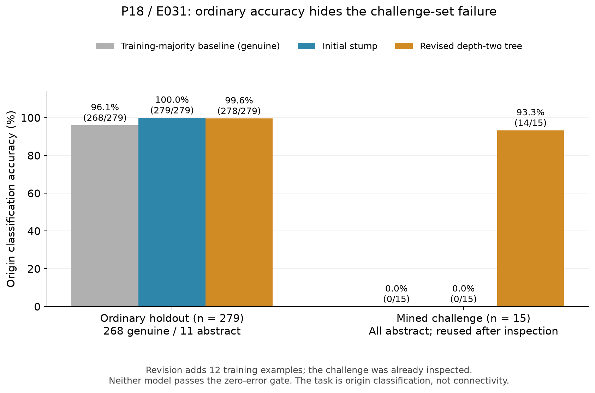
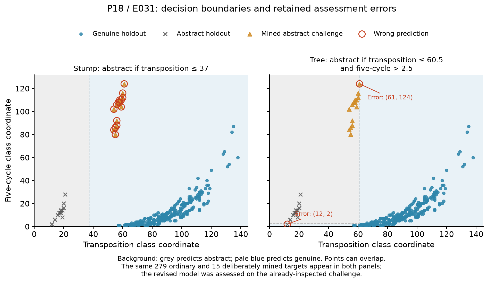
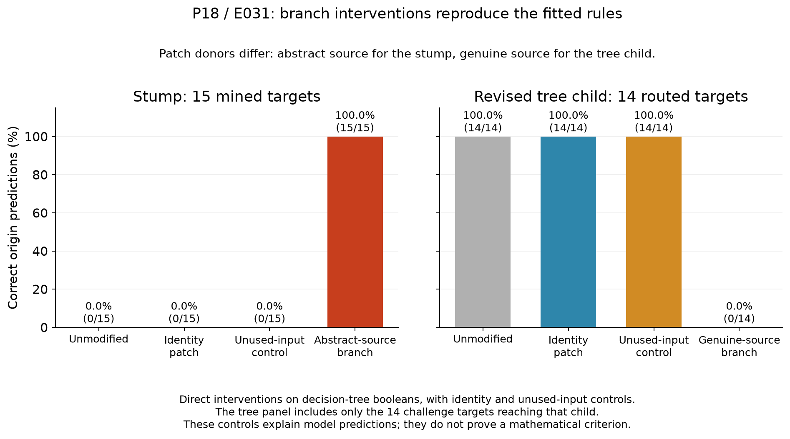
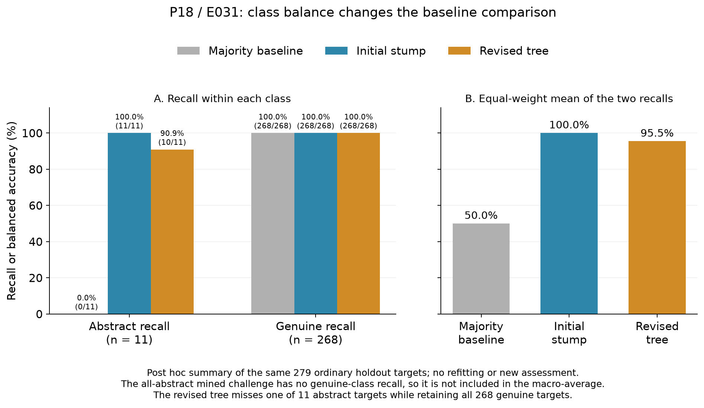
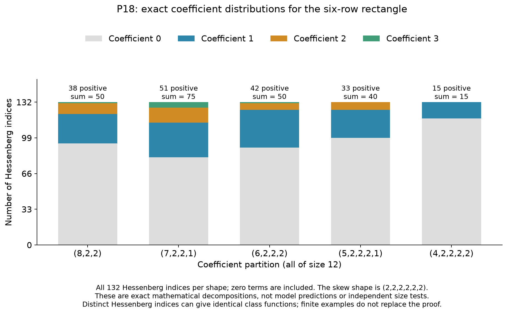

# P18 model figures

E031 fitted a decision stump, then a depth-two decision tree after adding 12 selected training examples. The target is origin in a retained genuine-shape census versus selected abstract examples. These models did not supply the width-two theorem's proof. The figures use the repository's Kronecker plotting style and preserve the failed reliability checks.

## Accuracy versus baseline



[Vector PDF](fig1_accuracy_vs_baseline.pdf). The training-majority class is genuine for both fits, so the fixed baseline predicts genuine on every assessment target. On the ordinary holdout, the baseline, stump, and tree score 268/279, 279/279, and 278/279. On the 15 mined abstract targets they score 0/15, 0/15, and 14/15. The revision's challenge set had already been inspected; improvement on it is not fresh generalization evidence. Both models fail the zero-error reliability gate. Training counts, on different-sized training sets, are reported separately in the [experiment summary](../paper/results.md#e031-separate-small-model-diagnostic).

## Decision boundaries and errors



[Vector PDF](fig2_decision_boundaries.pdf). Both panels show the same 279 ordinary and 15 mined assessment targets in the two original class coordinates. The stump uses a transposition threshold of 37. The tree predicts abstract when the transposition coordinate is at most 60.5 and the five-cycle coordinate exceeds 2.5. Its remaining errors are at `(12,2)` and `(61,124)`. Overlapping points remain at their exact coordinates; no jitter or subsampling is used.

## Branch interventions



[Vector PDF](fig3_branch_interventions.pdf). For the stump, replacing its branch boolean with that of an abstract training source corrects all 15 challenge predictions. For the revised tree child, replacing the child boolean with that of a genuine training source makes all 14 routed challenge predictions incorrect. Identity patches and unused-input controls preserve the unmodified predictions. The panels have different donor classes and different sample counts; they are controls on the implemented computations, not a comparison of training gains. The full records also contain tree-root interventions, which are not plotted here.

## Class-specific and balanced performance



[Vector PDF](fig4_class_balanced_performance.pdf). On the same ordinary holdout, the majority baseline recalls 0/11 abstract and 268/268 genuine targets; the stump recalls 11/11 and 268/268; the revised tree recalls 10/11 and 268/268. Equal-weight averaging of the two class recalls gives balanced accuracies of 50%, 100%, and approximately 95.5%. This complements raw accuracy, where the majority baseline scores 96.1% because genuine targets dominate. The mined challenge contains only abstract targets, so it has no genuine-class recall and is excluded from this two-class average. This is a post hoc descriptive summary, not a new test.

## Exact decomposition distributions



[Vector PDF](fig5_exact_decompositions.pdf). For each of the five retained coefficient partitions, the figure includes all 132 Hessenberg indices for the six-row rectangle, including zero coefficients. Positive counts are 38, 51, 42, 33, and 15; coefficient sums are 50, 75, 50, 40, and 15. Values and zero counts come from the [exact witnesses](../research/artifacts/historical/rectangles.json) and are checked against the [independent rectangle replay](../research/artifacts/publication_replay.json). These are mathematical coefficients, not model predictions, and all five partitions have size twelve. This is neither a size-extrapolation curve nor a substitute for the all-parameter proof.

## Coverage and limits

| Evidence question | Available here |
| --- | --- |
| Accuracy relative to a baseline and hard examples | Figure 1 |
| Interpretable model rules and their retained errors | Figure 2 |
| Controlled interventions with negative controls | Figure 3; actual boolean branch interventions |
| Effects of class imbalance | Figure 4; class recalls and their equal-weight mean |
| Exact mathematical examples supporting the theorem | Figure 5; complete bounded decompositions |
| Fresh larger-size model replication, size extrapolation, or isolated feature-addition gains | Not established by these selected experiments |

The tree revision changes both the training data and maximum depth; it is not a controlled ablation attributing its improvement to either change alone. The theorem is supported by exact calculations and a symbolic proof, not by the classifier's accuracy. The variety here therefore differs from the Kronecker collection rather than reproducing all of its experimental designs.

## Data and reproduction

[generate.py](generate.py) reads the frozen [stump records](../research/artifacts/historical/origin_stump.json) and [tree records](../research/artifacts/historical/origin_tree.json), evaluates the original prediction functions, checks agreement with the recorded accuracy counts, and plots the recorded interventions. It also computes class recalls and summarizes the exact rectangle witnesses. [plot_data.json](plot_data.json) contains all source checksums, numerical counts, histograms, and fitted rules. Negative challenge labels mean absence from the retained genuine-target census; they do not independently establish connectivity or disconnectedness of every translated fiber.

In an environment with Matplotlib installed, run from the repository root:

```bash
python3 monomial-immanants/graphs/generate.py --output-dir /tmp/p18-figures
```

Install the optional plotting dependency with `python3 -m pip install matplotlib` in a virtual environment. The retained images were generated with Matplotlib 3.11.2 and Python 3.14.4; other versions can produce different image bytes. Omitting `--output-dir` replaces the generated files in this directory. The standard-library research checks do not require Matplotlib. Plotting does not refit models, regenerate the originating census, or create a new assessment. Use the [origin replay](../README.md#verify-or-reproduce) for deterministic refitting on the frozen labels.
