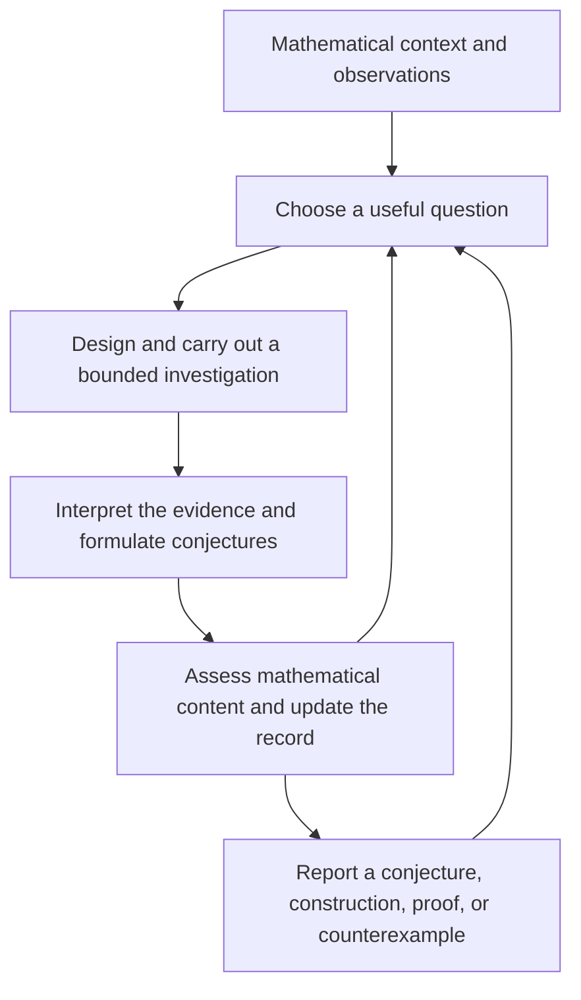

# PatternMiner

A portable agent workflow for generating mathematical conjectures through experiments, learned models, mechanistic interpretability, and mathematical reasoning.

Start with a broad mathematical question, a class of objects, or unexplained examples. The agent chooses useful subsidiary questions, designs experiments, studies the evidence, and revises the research direction. A natural, nontrivial conjecture is a successful outcome even when its proof remains open. Proofs and counterexamples can advance the investigation further.

## Start a project

Copy this directory into the project repository and give a capable coding agent this instruction:

> Read `patternminer/prompts/research.md` and follow it for this project. Our mathematical objective is: [describe the question, objects, or phenomenon]. Begin by inspecting the available context, proposing useful research questions, and confirming the resources for an initial investigation.

The agent will identify the relevant conventions, examples, references, and computation tools. It will prepare a short project brief and confirm resources before launching experiments. You do not need to supply a conjecture, a trained model, an exact decision procedure, or a proof-assistant environment.

Use the agent and tools already available in the project. The workflow itself consists of Markdown files and requires no installation, API key, orchestration service, or additional agent. A mathematical experiment may have its own dependencies and resource requirements, which must be agreed for that project.

## How the research proceeds

An investigation may involve exact computation, example generation, training a model, mechanistic interpretability, or a mathematical argument. The agent chooses methods according to what they could reveal. The learning task and representation can change as the mathematical question becomes clearer.

Before attempting to extract a dependable algorithm from a learned model, require near-perfect correctness on a stated mathematical domain, including difficult held-out examples. If that requirement fails, improve the model and data; limited mechanistic tests can help diagnose errors. A useful conjecture can still arise from imperfect predictions and receive its own independent mathematical assessment.

## Keep a small research record

The agent should choose a record directory, for example `research-notes/`, without overwriting existing work. Use the [templates](templates/PROJECT.md) to keep:

- `PROJECT.md`: the objective, conventions, available tools, reference policy, and confirmed resources.
- `STATE.md`: current questions, conjectures, strongest evidence, remaining resources, and next action.
- `conjectures/`: precise statements with motivation, evidence, status, and relation to existing mathematics.
- `experiments/`: bounded proposals and completed results, linked to their code and artifacts.

Reuse existing project records when they already serve these purposes. Keep raw data and checkpoints in the project's artifact storage, with stable references in the records. Record failures and superseded statements instead of overwriting their history.

To resume, ask the agent to read the research prompt, the project brief, and the current state. It should recover the existing resource agreement and unfinished work from those files.

## Prompts and guidance

| Task | Prompt | Detailed guidance |
|---|---|---|
| Begin, resume, and revise strategy | [Research](prompts/research.md) | This entry point |
| Formulate and assess conjectures | [Conjectures](prompts/conjecture.md) | [Research precedents](guides/sources.md) |
| Design experiments and select examples | [Experiments](prompts/experiment.md) | [Experiment record](templates/EXPERIMENT.md) |
| Design and train a useful model | [Models](prompts/models.md) | [Model design](guides/model-design.md) |
| Investigate the learned computation | [Mechanistic interpretability](prompts/mechanistic-interpretability.md) | [Methods and controls](guides/mechanistic-interpretability.md) |

Read detailed guidance when relevant to the current question. There is no requirement to run every method or load every reference at each iteration.

## Research outcomes

Assess a conjecture by its precision, natural formulation, substantive mathematical content, motivation, and relation to existing results. Record its truth status separately. Do not replace this judgment with the number of generated statements, prediction accuracy, or the duration of an unsuccessful proof search.

The [Schubert example](examples/schubert.md) illustrates earlier changes of strategy, including corrected experiments and a refuted conjecture. The [project context](examples/schubert-context.md) carries the current discoveries into a resumed investigation. An [actual trial of these prompts](examples/schubert-trial.md) used circuit interventions to motivate an exact obstruction to the sufficiency of local input data, then refined the interpretation using that obstruction.

The [accuracy continuation](examples/schubert-accuracy.md) tested the decision to improve the model before attempting to extract an algorithm. Five training continuations improved accuracy, but the difficult matched examples still failed the reliability requirement.

The subsequent [preparation for circuit interpretation](examples/schubert-readiness.md) improved the selected model to 97.90% on the historical S9 sample, verified a differentiable intervention interface, and found a stronger rank-column information obstruction. Fresh assessment still failed the behavioral requirement, so a full-domain circuit study remains pending.

The [source guide](guides/sources.md) documents the published precedents and recent methods informing the prompts. The Schubert trial tests one use of the workflow by its developing agent. Effectiveness across mathematical problems, conjecture quality, and the incremental contribution of the workflow still require separate evaluation.

The [expanded reliability investigation](examples/schubert-reliable-circuits.md)
passed development criteria but failed independent difficult-pair assessment.
It records the resulting change in assessment provenance, controlled causal
interventions, and a separate incidence calculation. The requested reliable
model and confirmed circuit interpretation remain unfinished.

The [relative-root continuation](examples/schubert-relative-roots.md) uses actual
attention and MLP interventions to motivate a more effective representation.
Further training again passes development criteria and fails independent
difficult-pair assessment. The record includes the resulting mathematical
statement, the subsequent model comparisons, and the continued distinction
between development analysis and independent confirmation.

The [full-scale continuation](examples/schubert-full-circuits.md) expands the
causal interventions, tests explicit attention approximations, and uses model
errors to investigate the limits of all Levi necessary length inequalities.
It completes training and a scan of all 96 attention heads and six MLPs on
5,445 development pairs. The final model passes all 27 development criteria
but fails replacement independent S10 pair assessment at 98.528%; the formal
confirmation populations remain protected. Mathematical deductions sharpen the
limits of proper Levi tests and bound the number of components needed for
necessary degree inequalities.
